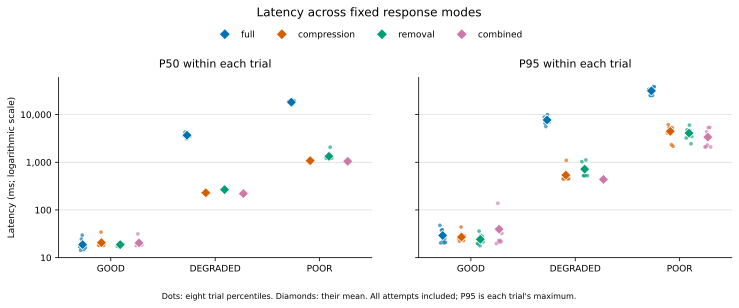
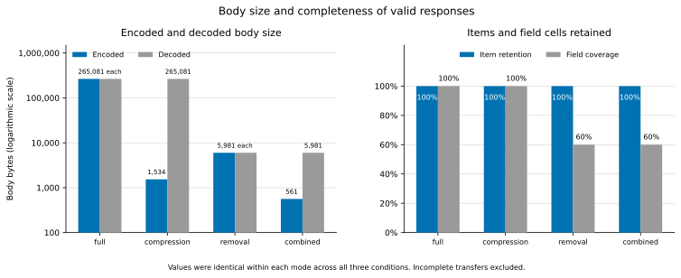

# Controlled response adaptation on EC2

Study date: 20 October 2026.

## Question and scope

I compared four ways of returning the same JSON fixture: a full response,
compression alone, optional-field removal alone, and both operations together.
The question was whether smaller responses reduced latency on a constrained
link, and how much content each mode retained.

I collected 960 measured attempts across GOOD, DEGRADED and POOR conditions.
Of these, 950 produced valid responses. The remaining ten were incomplete
transfers and remain in the raw data and latency calculations. This is a
comparison of fixed response modes. It does not measure how accurately the
gateway detects a connection's condition or chooses a policy automatically.

## Experiment

All modes used the same 100-item fixture at `/proxy/fixture/items`, the same
gateway source and host YAML, and the same request settings. I ran one gateway
process per mode, with a shared fixture and the research PostgreSQL and Redis
services. Caching was disabled, and valid responses had to report `BYPASS`.

| Mode | Port | Optional fields | Gzip |
| --- | --- | --- | --- |
| full | 8001 | Retained | Disabled |
| compression | 8002 | Retained | Enabled |
| removal | 8003 | Removed | Disabled |
| combined | 8004 | Removed | Enabled |

The client ran in the `agw-client` network namespace. Gateways listened on
`10.250.0.1`, with impairment applied to server egress on the dedicated
`agw-link` interface. The fixture was served separately on loopback port 9100.
The condition names below describe configured link treatments, not measurements
of a mobile network or labels predicted by the gateway.

| Condition | Added one-way egress delay | Configured loss | Configured rate |
| --- | --- | --- | --- |
| GOOD | None | None | No configured limit |
| DEGRADED | 200 ms | 1% | 1,000 kbit/s |
| POOR | 1,000 ms | 5% | 256 kbit/s |

Saved qdisc snapshots record these settings. The original and restored state
was `noqueue` for each condition. DEGRADED and POOR also include counters after
collection. These are records of the operator's setup and cleanup; the study
runner itself did not verify external impairment.

I used eight trials per condition and ten requests per mode in each trial:
80 attempts per mode and condition, or 320 per condition. Concurrency was two,
with no warm-up requests and a 15-second timeout per I/O operation. Requests
accepted gzip, with no retries or redirects. A transfer could last longer than
15 seconds while continuing to make progress.

Mode order used a seeded initial shuffle followed by rotation between trials
(seed `20261018`). The recorded condition order was GOOD, POOR, DEGRADED
(shuffle seed `20261020`). This balances mode starting positions but does not
make the trials independent. The session ran from 11:38:34 to 11:59:19 UTC,
20 minutes and 45 seconds in total.

I used ten requests per block instead of the runbook's 1,000-request example
to keep collection practical on the available instance. The clean-link smoke
checks and separate DEGRADED and POOR pilots are excluded from the 960 attempts.
The manifests record Linux on x86_64, two logical CPUs and Python 3.12.3.
They do not record the EC2 instance type, CPU model or resource utilisation.

## Measurement and calculation

I report latency in milliseconds from request submission through complete
encoded-body receipt or a transport error. Failed attempts remain in the main
latency results. Body size and completeness use valid responses only; missing
decoded-body measurements on incomplete transfers are not treated as zero.
Encoded bytes cover the HTTP response body, including gzip where used. They
exclude headers, TLS, TCP/IP overhead and retransmitted bytes.

The analyzer uses nearest-rank percentiles. With ten attempts in a trial, P50
is the fifth ordered latency and P95 is the tenth, which is the maximum.
The tables report the mean of eight trial percentiles, with their sample
standard deviation in parentheses. These are neither pooled 80-request
percentiles nor confidence intervals. The small blocks make the P95 especially
sensitive to individual slow attempts.

## Latency and response validity

Every mode/condition cell contains eight trials and 80 attempts. HTTP success
and valid-response counts were equal in this study: there were no complete 2xx
responses that failed content validation. There were no recorded timeouts.

| Condition | Mode | Valid / attempts | Mean trial P50, ms (SD) | Mean trial P95, ms (SD) |
| --- | --- | --- | --- | --- |
| GOOD | full | 80/80 | 18.8 (5.4) | 29.2 (10.5) |
| GOOD | compression | 80/80 | 20.6 (5.6) | 27.1 (7.1) |
| GOOD | removal | 80/80 | 18.7 (1.5) | 24.2 (6.3) |
| GOOD | combined | 80/80 | 20.4 (4.5) | 39.5 (40.4) |
| DEGRADED | full | 77/80 | 3,683.2 (351.8) | 7,701.7 (1,356.8) |
| DEGRADED | compression | 80/80 | 229.3 (2.6) | 537.2 (226.6) |
| DEGRADED | removal | 80/80 | 266.4 (3.4) | 717.6 (240.9) |
| DEGRADED | combined | 80/80 | 220.5 (2.5) | 436.7 (2.7) |
| POOR | full | 76/80 | 18,188.3 (1,229.0) | 31,341.2 (5,513.8) |
| POOR | compression | 77/80 | 1,080.1 (1.4) | 4,452.4 (1,467.0) |
| POOR | removal | 80/80 | 1,330.4 (300.1) | 4,086.9 (1,131.1) |
| POOR | combined | 80/80 | 1,046.8 (1.7) | 3,366.8 (1,457.1) |



Each dot is one trial percentile; diamonds show the mean across eight trials.
The vertical axes use a logarithmic scale. All attempts, including failed
transfers, contribute to these percentiles.

On the clean link, the mean trial P50 was between 18.7 and 20.6 ms for all four
modes. There was no consistent latency advantage from reducing the response.
The combined mode's mean trial P95 was 39.5 ms with an SD of 40.4 ms; one trial
had a maximum latency of 138.3 ms. The small body did not eliminate variability.

On DEGRADED, full responses had a mean trial P50 of 3,683.2 ms, compared with
229.3 ms for compression and 220.5 ms for the combined mode. On POOR, the same
figures were 18,188.3, 1,080.1 and 1,046.8 ms. These differences describe this
fixture and setup; they do not establish an expected improvement for other APIs.

Failures can finish quickly and lower an all-attempt percentile without
delivering a usable response. The cells containing failures therefore also
need the successful-only calculation below. In the other nine cells,
successful-only and all-attempt latency results are identical.

| Condition | Mode | Successful attempts | Successful-only P50, ms (SD) | Successful-only P95, ms (SD) |
| --- | --- | --- | --- | --- |
| DEGRADED | full | 77 | 3,733.4 (413.8) | 7,701.7 (1,356.8) |
| POOR | full | 76 | 18,709.4 (1,634.6) | 31,341.2 (5,513.8) |
| POOR | compression | 77 | 1,205.5 (354.1) | 4,452.4 (1,467.0) |

## Body size and completeness

The fixture has three required leaf fields (`id`, `title`, `meta.category`)
and two optional ones (`body`, `meta.debug`) in each of 100 items. Full content
therefore contains 500 field cells. Removal retains 300 required cells and
omits 200 optional cells, giving field coverage of 0.60.

The values below were the same for every valid response in a given mode across
all three conditions. Valid-body counts combine the three conditions. Byte
reduction is relative to the full, uncompressed body.

| Mode | Valid bodies | Encoded bytes | Decoded bytes | Byte reduction | Item retention | Field coverage |
| --- | --- | --- | --- | --- | --- | --- |
| full | 233 | 265,081 | 265,081 | 0.00% | 1.00 | 1.00 |
| compression | 237 | 1,534 | 265,081 | 99.42% | 1.00 | 1.00 |
| removal | 240 | 5,981 | 5,981 | 97.74% | 1.00 | 0.60 |
| combined | 240 | 561 | 5,981 | 99.79% | 1.00 | 0.60 |



Compression alone preserved the complete fixture while reducing the encoded
body to 1,534 bytes. Removal alone produced 5,981 bytes, which was larger than
the compressed full response despite omitting fields. Combining removal and
compression reduced the body to 561 bytes, saving another 973 bytes compared
with compression alone, at the cost of the optional fields.

All valid responses retained the 100 items and the correct required values.
That does not make the reduced responses equivalent to the full response.
Coverage weights each field cell equally; it does not measure the usefulness
of the omitted data to an application.

## Paired comparisons

I matched modes within each trial and calculated treatment minus reference
before averaging the eight differences. Negative values mean a lower latency
for the treatment. Parentheses contain the sample SD of the paired differences,
not an uncertainty interval. The raw analysis preserves every trial difference.

| Condition | Treatment - reference | P50 difference, ms (SD) | P95 difference, ms (SD) |
| --- | --- | --- | --- |
| GOOD | compression - full | 1.9 (3.3) | -2.1 (10.5) |
| GOOD | combined - removal | 1.7 (4.0) | 15.3 (36.2) |
| GOOD | removal - full | -0.04 (5.8) | -5.0 (12.3) |
| GOOD | combined - compression | -0.2 (7.4) | 12.4 (42.5) |
| GOOD | combined - full | 1.6 (5.3) | 10.3 (39.3) |
| DEGRADED | compression - full | -3,453.9 (351.5) | -7,164.5 (1,222.2) |
| DEGRADED | combined - removal | -45.9 (3.0) | -280.9 (240.5) |
| DEGRADED | removal - full | -3,416.9 (352.8) | -6,984.1 (1,356.2) |
| DEGRADED | combined - compression | -8.8 (4.1) | -100.5 (227.2) |
| DEGRADED | combined - full | -3,462.7 (352.0) | -7,265.0 (1,357.2) |
| POOR | compression - full | -17,108.2 (1,228.1) | -26,888.8 (5,799.0) |
| POOR | combined - removal | -283.6 (300.5) | -720.1 (1,615.3) |
| POOR | removal - full | -16,857.9 (1,415.8) | -27,254.3 (6,069.6) |
| POOR | combined - compression | -33.3 (2.3) | -1,085.6 (1,728.1) |
| POOR | combined - full | -17,141.5 (1,229.5) | -27,974.4 (5,617.4) |

These comparisons separate compression from field removal. Compression reduced
latency under both impaired conditions while preserving all fields. Adding
removal to an already compressed response gave a smaller additional difference:
8.8 ms in mean trial P50 on DEGRADED and 33.3 ms on POOR. On GOOD, the paired
differences did not show a consistent advantage across P50 and P95.

## Incomplete transfers

| Condition | Mode | Exception | Count |
| --- | --- | --- | --- |
| DEGRADED | full | RemoteProtocolError | 3 |
| POOR | compression | ReadError | 1 |
| POOR | compression | RemoteProtocolError | 2 |
| POOR | full | RemoteProtocolError | 4 |

There were nine `RemoteProtocolError` observations and one `ReadError`.
All ten were labelled `incomplete_transport`; none was labelled a timeout.
The saved observations do not establish why these connections failed. Packet
loss was part of the treatment, but I cannot attribute individual errors to it
from the exception names alone.

The 950/960 valid-response rate is an outcome of this run, not a reliability
guarantee. In particular, 80/80 valid responses for removal and combined in each
condition does not establish that those modes prevent transport failures.

## What the results support

For this fixture, optional-field removal reduced body size,
and smaller representations were associated with lower latency on the two
impaired links. Removal also reduced field coverage from 1.00 to 0.60.
The four controls show that compression and field removal have different
effects: gzip alone achieved most of the encoded-byte reduction without
omitting content.

I would not choose field removal solely from the smallest byte count. In this
workload, the application would need to justify losing the optional fields for
the additional saving over compression alone. I did not measure application
task completion, user preference or semantic utility.

## Limits of this study

- This is one session on one host with eight small trials per condition.
  It does not establish statistical significance or independent replication.
- The optional-heavy, repetitive fixture strongly favours both gzip and removal.
  Different payloads may compress less or make omitted fields more valuable.
- The client, gateways, fixture and supporting services shared a host. CPU load,
  validation overhead, port/process assignment and competing work may affect the
  measurements. I did not measure server or client resource costs.
- Configured one-way delay, loss and rate do not reproduce a measured cellular
  path. Loss was not seeded, and neither condition order nor HTTP scheduling
  makes this an exact replay of network events.
- These fixed modes bypass the automatic policy decision. Classifier accuracy,
  adaptive POOR skeletons, cached responses and outage recovery were not evaluated.
- Concurrency two and 960 attempts do not establish maximum throughput, memory
  capacity, multi-user behaviour or production readiness.
- Response bodies are hashed rather than archived. The raw rows preserve the
  original validator's results, but a different validator cannot inspect those
  bodies retrospectively. The ten transport-error causes remain unresolved.

The next research steps are independent replication, less repetitive payloads,
and an application-specific measure of whether the retained content is useful.
Automatic policy selection and resource overhead need separate experiments.

## Evidence and reproduction

Gateway and runner source revision:
`14b5adfba91a0ee35205c7975f51e07a7a5e7570`.
The manifests record a clean tracked source state and the same operator-attested
server revision. Previously reviewed local Git exclusions covered pre-existing
environments, unused local configuration and old results; a clean Git status
does not mean that the host contained only tracked files.

This revision was also used during earlier setup attempts. I excluded those
attempts, the smoke checks and the pilots from the reported dataset. The three
final manifests each record 320 attempts, a clean source state and the revision
above. All 950 valid responses passed the requested-mode, encoding, fixture and
metadata checks. This supports the four-mode comparison at the response level.
The recorded server revision is an operator attestation rather than independent
verification of the running server code.

The original 23-file dataset is published in evidence commit
[`266011cbef7e06fa32d81530e09d8ff829e7670b`](https://github.com/joelanarba/adaptive-gateway/tree/266011cbef7e06fa32d81530e09d8ff829e7670b/research/evidence/controlled_2026-10-20).
It contains raw observations, manifests, analyses, qdisc records and the session
summary. `ARTIFACT_SHA256.json` covers the other 22 files. Verification matched
all catalog hashes, the 65 recorded source-file hashes and the host YAML hash.
Reanalysis of all three raw files exactly reproduced the saved analyses.

| Condition | Raw requests.jsonl SHA-256 |
| --- | --- |
| GOOD | `2bfbda821a0e53923315510fa49efd73f2c70a2db713bb41e24a66b0c4369346` |
| DEGRADED | `cb58c203e8ed311004aa31e932e40046e5c8e9d78bf1b9e3675852757484fb2b` |
| POOR | `3421d31df4009b35e93c202f3ec96f6e079bf34f2a0e563d626fd36ee4836170` |

With the evidence commit available locally, the following Bash commands export
the committed bytes into a new temporary directory and recalculate each
condition. They make no HTTP requests to the gateways and do not change Git
history or the working tree. Disabling line-ending conversion for the export
matters on Windows: CRLF conversion changes the raw-file hashes.

```bash
(
set -euo pipefail
evidence_commit=266011cbef7e06fa32d81530e09d8ff829e7670b
work=$(mktemp -d)
git -c core.autocrlf=false archive "$evidence_commit" \
  research/evidence/controlled_2026-10-20 | tar -x -C "$work"
for condition in GOOD DEGRADED POOR; do
  python benchmarks/study_analysis.py \
    "$work/research/evidence/controlled_2026-10-20/$condition" \
    --out "$work/reanalysis-$condition"
done
printf 'Reanalysis output: %s\n' "$work"
)
```

Use Python 3.11 or 3.12 from the source checkout above. Full measurement
definitions and collection instructions are in the
[methodology](EXPERIMENT_METHODOLOGY.md) and [EC2 runbook](EC2_RESEARCH_RUNBOOK.md).
The 19 files in the [preliminary snapshot](../research/evidence/preliminary_2026-10-18/README.md)
remain unchanged and are excluded from these calculations.

The earlier local validation report records 284 pytest tests, Ruff, Black and
`git diff --check` passing. Those are software checks, separate from this EC2
experiment. The [Quality workflow for the evidence commit](https://github.com/joelanarba/adaptive-gateway/actions/runs/39536416813)
also completed successfully. No application tests or live experiments were rerun
to write this report.
